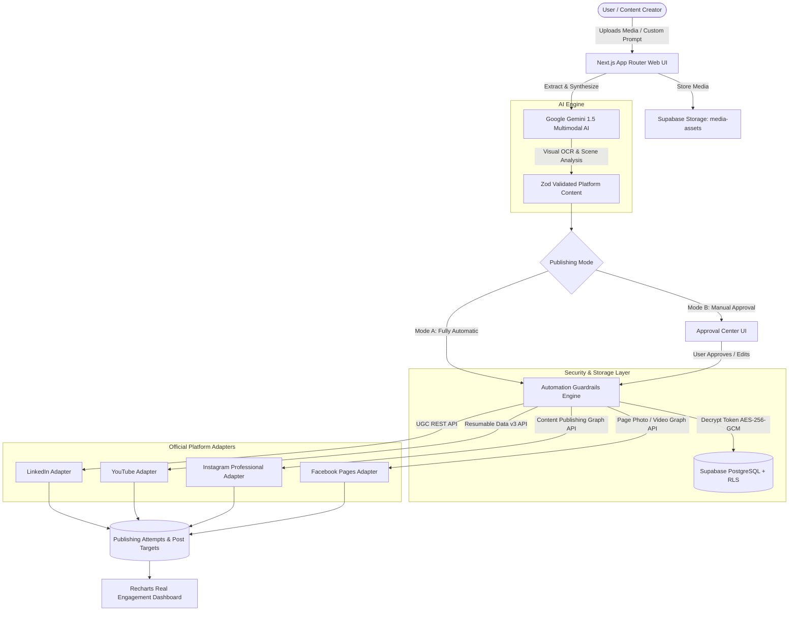
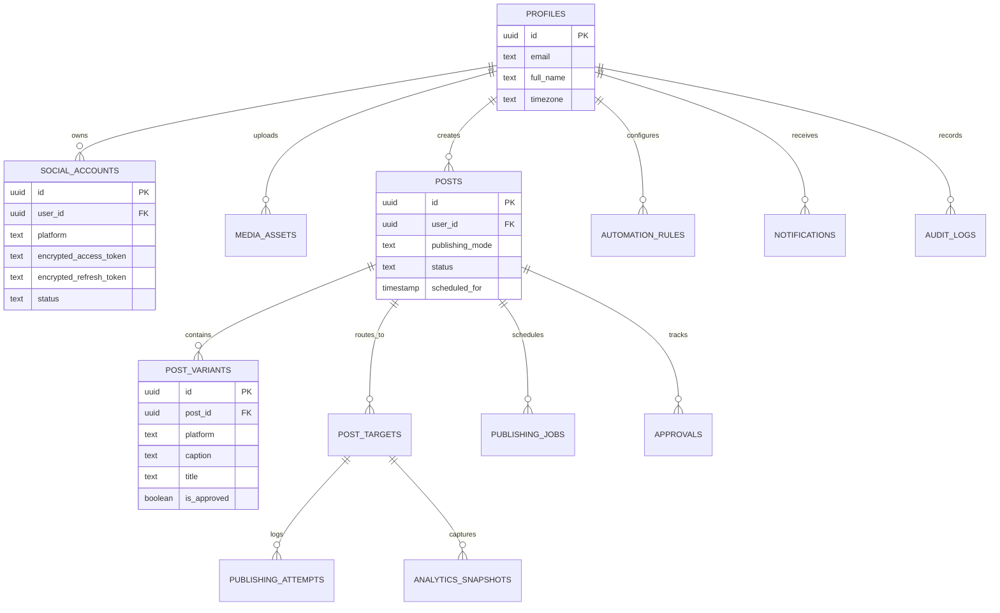

# SocialSync AI — Intelligent Multi-Platform Social Media Automation System

> **Final Year Major Project**  
> **Lead Full-Stack & AI Engineer**: Jeffrey Rathinam  
> **Institution**: Rathinam Group of Institutions  
> **UI/UX Design Framework**: Google Stitch Design System  
> **Tech Stack**: Next.js 14 (App Router), TypeScript, Tailwind CSS, Supabase (PostgreSQL, Auth, Storage, RLS), Google Gemini Multimodal AI, Official OAuth 2.0 (LinkedIn, YouTube, Instagram, Facebook).

---

## 1. Executive Summary

**SocialSync AI** is a production-grade, multi-user autonomous social media distribution platform. Users upload visual media (posters, banners, flyers, videos, or reels) once. **Google Gemini Multimodal AI** inspects visual elements, extracts embedded typography via OCR, assesses sentiment and color aesthetics, and generates distinct, platform-optimized captions, titles, and hashtags for **LinkedIn, YouTube, Instagram, and Facebook**.

The system features two operational paradigms:
1. **Mode A — Fully Automatic**: Upload → Vision Analysis → Multimodal Synthesis → Rule Validation → Queue → Autonomous Publish → Diagnostics.
2. **Mode B — Manual Approval**: Upload → Synthesis → Human-in-the-Loop Review → Multi-Platform Editing → One-Click Authorization → Scheduled / Immediate Release.

---

## 2. Google Stitch Design System Integration

The application faithfully implements Google Stitch's SaaS design tokens and component specifications:

- **Color Tokens**:
  - **Brand Accent**: Deep Indigo (`#4f46e5`, `#6366f1`) & Electric Violet (`#8b5cf6`, `#7c3aed`).
  - **Dark Canvas (Obsidian)**: `#0b0f19` (Canvas), `#111827` (Card Surface), `#1e293b` (Raised Panels), `#1f2937` (Subtle Borders).
  - **Light Canvas**: `#f8fafc` (Slate 50), `#ffffff` (Pure White Cards), `#e2e8f0` (Borders).
  - **Status Tokens**: Emerald (`#10b981`), Amber (`#f59e0b`), Rose (`#ef4444`), Sky (`#3b82f6`).
- **Typography & Numerals**: `Inter` font stack with `tabular-nums font-mono` for all KPIs, percentages, and timestamps.
- **Component Geometry**: 8px buttons/inputs (`rounded-lg`), 12px cards (`rounded-xl`), 16px modals (`rounded-2xl`), 9999px status badges with animated pulse dots.
- **Responsive Layout**: Desktop collapsible sidebar, sticky top header with multi-platform API health indicator, touch-optimized mobile drawers.

---

## 3. High-Level Architecture



---

## 4. Database Schema (12 Tables with Strict RLS)



---

## 5. Security & Cryptographic Protocols

1. **Token Encryption at Rest**:
   - OAuth tokens are encrypted with `AES-256-GCM` using an initialization vector (IV) and authentication tag.
   - Plaintext tokens are never stored in PostgreSQL and are never exposed to the client browser.
2. **State Token CSRF Protection**:
   - OAuth state parameters contain user ID, platform, timestamp, random nonce, and an `HMAC-SHA256` signature.
3. **Database Tenant Isolation (RLS)**:
   - Supabase Row Level Security ensures that users cannot query or mutate data belonging to other accounts.

---

## 6. Official Social Media API Implementations

| Platform | Official Endpoint | Minimum Approved Scopes | Media Formats |
| :--- | :--- | :--- | :--- |
| **LinkedIn** | `https://api.linkedin.com/v2/ugcPosts` | `openid, profile, email, w_member_social` | Images (JPEG/PNG), Video |
| **YouTube** | `https://www.googleapis.com/upload/youtube/v3/videos?uploadType=resumable` | `youtube.upload, youtube.readonly` | MP4, MOV, WEBM |
| **Instagram** | `https://graph.facebook.com/v21.0/{ig-user-id}/media` | `instagram_basic, instagram_content_publish` | JPEG/PNG (4:5 to 1.91:1), Reels |
| **Facebook** | `https://graph.facebook.com/v21.0/{page-id}/photos` | `pages_manage_posts, pages_read_engagement` | Text, Images, Videos |

> **Note on Provider Approvals**: In accordance with Meta and LinkedIn developer policies, production publishing to accounts other than designated developer test users requires App Review submission. When credentials are not yet configured or an account is missing Page admin rights, the platform provides clear diagnostics and actionable instructions.

---

## 7. Setup & Local Development

### Prerequisites
- Node.js `v20+` or `v24+`
- Supabase project credentials
- Google Gemini API key

### Installation
```bash
# Clone and enter directory
cd d:\Postgram

# Copy environment variables template
cp .env.example .env.local

# Run TypeScript check
npm run typecheck

# Run Automated Unit Tests
npm test

# Run Next.js Production Build
npm run build

# Start Development Server
npm run dev
```

Visit `http://localhost:3000` to access SocialSync AI.
